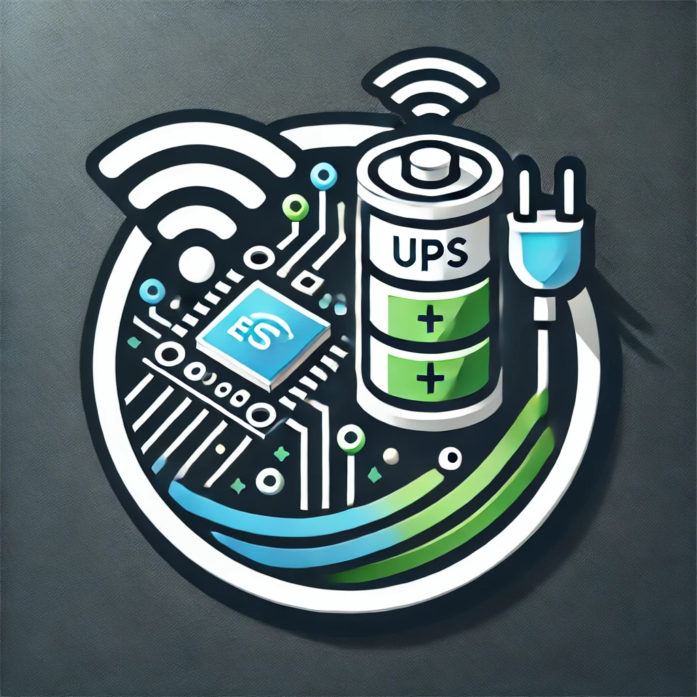

<p align="center">
  <a href="" rel="noopener">
 </a>
</p>

<h3 align="center">UPS ESP32-S3 Server — MQTT / WiFi (Ragtech Protocol)</h3>

<div align="center">

[]()
[](https://github.com/antunesls/UPS_ESP32_tinySrv/issues)
[](https://github.com/antunesls/UPS_ESP32_tinySrv/pulls)
[](https://github.com/antunesls/UPS_ESP32_tinySrv/releases)
[](/LICENSE)

</div>

---

<p align="center">
Monitoramento moderno para nobreaks Ragtech via USB-CDC no ESP32-S3. <br>
Publica métricas e alarmes em MQTT com integração ao Home Assistant, e oferece painel web completo com configuração e OTA.<br>
<i>Projeto criado e otimizado originalmente para a linha <b>Easy Pro 1200</b>.</i>
</p>

---

## 🔍 Sobre o projeto

O **UPS ESP32-S3 Server** centraliza o monitoramento do seu nobreak Ragtech (originalmente projetado e testado na linha **Easy Pro 1200**) ao conectá-lo a um ESP32-S3 via interface USB CDC/ACM.

O sistema atua de forma independente:
- Comunica-se com o UPS usando o **mesmo protocolo do software oficial Ragtech Supervise** (obtido por engenharia reversa do `device.dll` com Ghidra)
- Identifica automaticamente o **modelo** do nobreak e aplica as fórmulas corretas de cada um
- Lê tensão, corrente, carga, frequência, bateria e temperatura, além de 23 flags de status
- Integra-se de forma 100% autônoma ao **Home Assistant** via MQTT Auto-Discovery
- Apresenta um **Painel Web Responsivo** para monitoramento, configuração e atualizações via ar (OTA)

### 🔒 Somente leitura — o nobreak nunca é comandado

O firmware **apenas lê** o nobreak. Uma trava no código (`ups_frame_allowed()` em `main/ups.c`) só permite enviar pela USB pedidos de leitura e o quadro de identificação usado pelo Supervise. Qualquer outro comando — escrita de registradores, desligamento programado, supervisão — é bloqueado antes de sair do ESP e registrado no log como `Quadro bloqueado`.

> Versões anteriores à 3.1.0 enviavam no boot um comando que não faz parte do protocolo do Supervise (`FF FE 00 8E 01 8F`) e havia relatos de o nobreak desligar ao reiniciar o ESP. A partir da 3.1.0 esse comando foi removido e a trava acima impede que algo parecido volte a acontecer.

### Hardware Suportado

- **Nobreak:** Ragtech família 10 — linha **Easy Pro / NEP / TORO / INNERGIE / ONEUP** com USB CDC `0x04D8:0x000A`. Modelos reconhecidos automaticamente:

  | Saída 115 V (TI) | Saída 220 V (M2) | Banco de bateria |
  |---|---|---|
  | EASY 600 / 700 / 900 / 1200 TI | EASY 600 / 700 / 900 / 1200 M2 | 12 V |
  | EASY 1300 / 1400 / 1600 / 1800 / 2000 / 2200 TI | EASY 1300 / 1400 / 1600 / 1800 / 2000 / 2200 M2 | 24 V |

  Testado em hardware real: **Easy Pro 1200 TI** (modelo 6).
- **Placa Controladora:** ESP32-S3 (Testado com YD-ESP32-S3 com LED RGB WS2812 no GPIO 48). Requer 8 MB de flash (partições duplas de OTA).

---

## ✨ Principais Recursos e Funcionalidades

📊 **Métricas Analógicas Detalhadas**
- Tensão de entrada e de saída
- Corrente de saída e percentual de carga
- Frequência de saída (calculada como no Supervise, a partir dos osciladores de referência do nobreak)
- Potência de entrada/saída (W) e Energia Acumulada (kWh) com persistência em memória NVS
- Temperatura interna
- Tensão e capacidade (%) da bateria
- Modelo, potência nominal (VA) e versão de firmware do nobreak

⚠️ **Monitoramento de Alarmes e Status (23 Flags)**
- Operação: `op_battery`, `op_checkup`, `no_v_input`, `lo_v_input`, `hi_v_input`, `hi_p_output`, `sync_input`
- Bateria: `lo_battery`, `no_battery`, `old_battery`, `more_battery`, `less_battery`
- Falhas: `fail_overload`, `fail_inverter`, `fail_shortcircuit`, `fail_overtemp`, `fail_end_battery`, `fail_abnormal_vout`, `fail_abnormal_vbat`
- Modos: `remote_control_active`, `supervise_on`, `powerlook_on`, `nightoff_on`

🏠 **Integração Nativa com Home Assistant**
- **MQTT Auto-Discovery:** Todos os sensores analógicos (`sensor`) e de estado (`binary_sensor`) aparecem automaticamente na dashboard do HA, sem necessidade de configuração manual em arquivos YAML. Identificação única via MAC Address.

🌐 **Painel Web Status & Controle (Web UI)**
- Dashboard em tempo real atualizada a cada 5 s.
- Badges coloridos para os status e alarmes ativos (verde = ok, amarelo = alerta, vermelho = erro).
- **Configuração pela página:** broker MQTT (URL, porta, usuário, senha), intervalo de leitura do nobreak e calibração de corrente. Salva no NVS e reinicia para aplicar. A senha nunca é exibida — deixe o campo em branco para mantê-la.
- Visualizador de logs do sistema no navegador.
- **Atualização Remota (OTA)** via arquivo `.bin`.

⚙️ **Gerenciamento de Rede (Captive Portal)**
- Inicialização via Hotspot WiFi (`UPS-ESP32-XXXXXX`, LED Magenta).
- Configure sua rede doméstica acessando `http://192.168.4.1` na primeira inicialização.
- Para redefinir as credenciais, segure o botão BOOT por 3 segundos durante o boot.

💡 **Sinalização Visual Inteligente**
- Suporte a LED WS2812 embutido na placa.
- Cores e padrões por estado: Inicialização (Amarelo), Wi-Fi (Azul Rápido), MQTT (Azul Lento), Conectando ao UPS (Laranja), Tudo OK (Verde Fixo), OTA (Ciano), Configuração AP (Magenta) e Falhas (Vermelho).

---

## 🚀 Primeiros Passos

### Pré-requisitos

- ESP-IDF **v5.5+** ou **v6.x** (para compilação local)
- ESP32-S3 com 8 MB de flash
- Nobreak Ragtech com porta USB (CDC)

### Instalação Rápida (Binário)

Na aba de [Releases](https://github.com/antunesls/UPS_ESP32_tinySrv/releases) há dois arquivos:

| Arquivo | Uso |
|---|---|
| `UPS_ESP32_tinySrv-vX.Y.Z-full.bin` | **Primeiro flash** via USB — inclui bootloader, tabela de partições e firmware |
| `UPS_ESP32_tinySrv-vX.Y.Z.bin` | **Atualização OTA** pelo painel web |

Primeiro flash:

```bash
esptool.py --chip esp32s3 --port /dev/ttyUSB0 --baud 460800 write_flash 0x0 UPS_ESP32_tinySrv-vX.Y.Z-full.bin
```

Atualização: acesse `http://<IP do ESP32>` → card **Atualizar Firmware (OTA)** → envie o `.bin` (sem `-full`).

### Configuração

Depois de conectar ao WiFi pelo portal, abra `http://<IP do ESP32>` e preencha o card **Configuração** (broker MQTT, usuário, senha, intervalo de leitura). Os valores ficam no NVS e sobrevivem a reinícios e atualizações OTA.

Enquanto nada for salvo pela página, o firmware usa os valores definidos no `menuconfig` na compilação.

### Compilando do Código Fonte

```bash
git clone https://github.com/antunesls/UPS_ESP32_tinySrv.git
cd UPS_ESP32_tinySrv
idf.py set-target esp32s3
idf.py menuconfig   # Valores padrão de MQTT, LED, porta web, etc.
idf.py build flash monitor
```

No `menuconfig`, confirme também em **Partition Table** a opção *Custom partition table CSV* (`partitions.csv`) e em **Serial flasher config** o tamanho de flash **8 MB** — sem isso o firmware não cabe na partição padrão.

> No ESP-IDF 6.x, os componentes `usb` e `mqtt` saíram do núcleo do framework; o `main/idf_component.yml` já os adiciona automaticamente a partir dessa versão.

**Principais configurações no `menuconfig`** (servem de padrão; podem ser alteradas depois pela página web):
- **MQTT Configuration:** URL do broker, porta, usuário e senha.
- **UPS Configuration:** intervalo de leitura e calibração de corrente (fallback).
- **LED Configuration:** GPIO do WS2812.
- **Web Server Configuration:** porta HTTP.

---

## 🔌 Protocolo Ragtech (resumo)

Extraído do `device.dll` do Supervise. Cada pedido tem 6 bytes:

```text
[0xA0|ID, cmd, addr_hi, addr_lo, n, checksum]     cmd 0x04 = ler n registradores
```

1. **Identificação:** `AF FE 8E 01 00 3C` → o nibble baixo da resposta é o ID (padrão `0xA`, cabeçalho `0xAA`).
2. **Detecção do protocolo:** leitura de 1 registrador em `0x0085`. Protocolo 4 usa `checksum = addr_hi + addr_lo + n`; protocolo 3 soma os 5 bytes.
3. **Leitura:** faixas `0x80/30`, `0xF3/1`, `0x136/1`, `0x171/4` e `0x202/2`. A resposta é `0xAx` seguido de `n` bytes de dados.

As fórmulas de conversão de cada modelo seguem o `devices.xml` do Supervise (família 10).

---

## 🗂️ Tópicos MQTT (Sub/Pub)

O sistema publica utilizando o Endereço MAC do ESP32 para garantir unicidade na rede.

```text
UPS_ESP32_tinySrv/<MAC>/availability            -> Estado "online"/"offline"
UPS_ESP32_tinySrv/<MAC>/Sensor_<chave>          -> Valor métrico
UPS_ESP32_tinySrv/<MAC>/status/<flag>           -> Estado ON ou OFF
homeassistant/sensor/.../config                 -> Payload de auto-discovery
homeassistant/binary_sensor/.../config          -> Payload de auto-discovery
```

---

## 🧩 API HTTP

| Método | Rota | Descrição |
|---|---|---|
| GET | `/` | Painel web |
| GET | `/api/metrics` | Métricas analógicas |
| GET | `/api/status` | Flags de status e alarmes |
| GET | `/api/info` | Versão do firmware, uptime, modelo/firmware/protocolo do nobreak |
| GET | `/api/config` | Configuração atual (a senha não é retornada, só `mqtt_pass_set`) |
| POST | `/api/config` | Salva a configuração (`application/x-www-form-urlencoded`) e reinicia |
| GET | `/api/logs` | Últimas linhas de log |
| GET | `/api/raw` | Último pacote bruto lido do nobreak (diagnóstico) |
| POST | `/ota` | Envio de firmware |

> ⚠️ O painel e a API não têm autenticação: qualquer dispositivo na rede local pode alterar a configuração ou enviar firmware. Mantenha o ESP32 em uma rede confiável.

---

## 🗃️ Estrutura do Código Fonte

- `main.c` — Ponto de entrada / inicialização geral.
- `ups.c/.h` — USB CDC Host, protocolo Ragtech, tabela de modelos, decodificação e trava somente leitura.
- `app_config.c/.h` — Configuração editável pela web, persistida no NVS.
- `web_server.c/.h` e `web_ui.h` — Servidor HTTP, endpoints REST e interface embarcada.
- `ups_mqtt.c/.h` — Publicação MQTT e registro do Auto-Discovery.
- `wifi_manager.c/.h` — Portal AP, credenciais no NVS e reconexão.
- `led_status.c/.h` — Sinalização RGB (WS2812).
- `log_buffer.c/.h` — Buffer circular de logs exibido na web.

---

## 👨‍💻 Autores & Agradecimentos

Projeto mantido e desenvolvido por [@antunesls](https://github.com/antunesls).

*Referências notáveis para a decodificação do protocolo:*
- Software Ragtech Supervise (`device.dll` e `devices.xml`)
- [@RafaelEstevamReis/HA_Ragtech_UPS](https://github.com/RafaelEstevamReis/HA_Ragtech_UPS)
